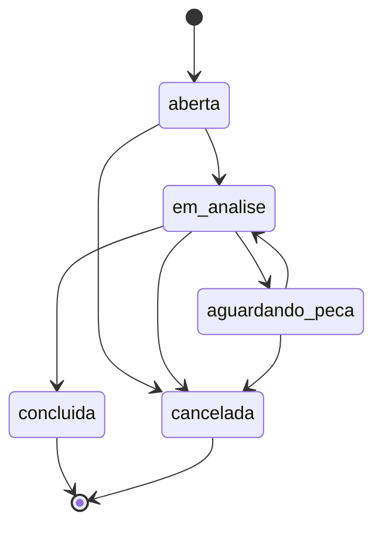
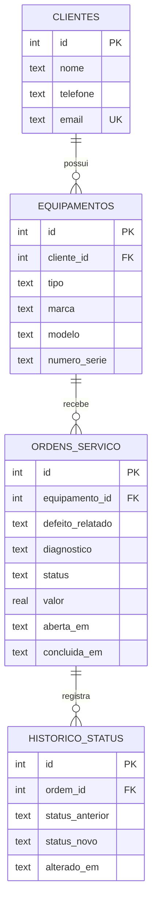

# Sistema de Ordens de Serviço

API para uma assistência técnica de computadores. Ela registra os clientes e os equipamentos que eles trazem, abre ordens de serviço e acompanha cada uma até o fim, guardando o histórico de todas as mudanças de status.

É feita em Python com FastAPI e SQLite. Fiz para praticar modelagem de banco, API REST e testes automatizados num problema que eu conheço de perto: o balcão de uma assistência.

## O que ele faz

O cadastro de clientes pede nome e telefone, com e-mail opcional, e recusa e-mail repetido. Cada cliente pode ter vários equipamentos, com tipo, marca, modelo e número de série.

Uma ordem nasce como "aberta", ligada a um equipamento e com o defeito relatado. A partir daí o status só muda por um caminho permitido, e cada mudança vai para o histórico com data e hora. O diagnóstico e o valor podem ser preenchidos enquanto a ordem está em andamento. Depois de concluída ou cancelada, ela fica travada.

Um relatório simples mostra quantas ordens existem em cada status e quanto foi faturado com as concluídas.

Qualquer mudança fora desse caminho volta com erro 409.

## Rotas

| Método | Rota | O que faz |
|---|---|---|
| POST, GET | `/clientes` | Cria e lista clientes (`?busca=` filtra pelo nome) |
| GET, PUT, DELETE | `/clientes/{id}` | Consulta, atualiza e remove um cliente |
| POST, GET | `/equipamentos` | Cria e lista equipamentos (`?cliente_id=` filtra) |
| GET | `/equipamentos/{id}` | Consulta um equipamento |
| POST, GET | `/ordens` | Abre e lista ordens (`?status=` filtra) |
| GET, PATCH | `/ordens/{id}` | Consulta com o histórico e atualiza diagnóstico e valor |
| PATCH | `/ordens/{id}/status` | Muda o status seguindo o caminho permitido |
| GET | `/relatorios/resumo` | Ordens por status e valor das concluídas |

A documentação interativa que o FastAPI gera fica em `/docs`.

## Banco de dados

O esquema tem chaves estrangeiras, restrições `CHECK` (tipo do equipamento, status e valor não negativo) e índices nas colunas que as consultas mais usam. Usei SQL puro com o módulo `sqlite3` e sem ORM, de propósito, para aprender as consultas.

## Decisões

- Abrir a ordem e gravar a primeira linha do histórico acontecem na mesma transação: se uma falha, a outra não fica pela metade.
- Um cliente que tem ordens não pode ser removido. A chave estrangeira impede e a API responde 409.
- Os erros têm significado: 404 quando não encontra, 409 em conflito (e-mail repetido, status inválido) e 422 quando o dado enviado não passa na validação.

## Testes

Há testes automatizados com pytest para e-mail repetido, dados inválidos, equipamento de um cliente que não existe, o fluxo completo de uma ordem, transição de status inválida, ordem encerrada que não pode ser editada, remoção de cliente com ordens e o relatório, que só soma as concluídas.

## O que falta

Uma tela web que use a API, Docker, GitHub Actions rodando os testes, login e uma sugestão de prioridade com IA a partir da descrição do defeito.
