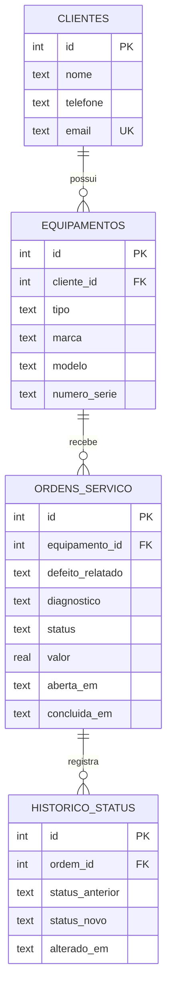
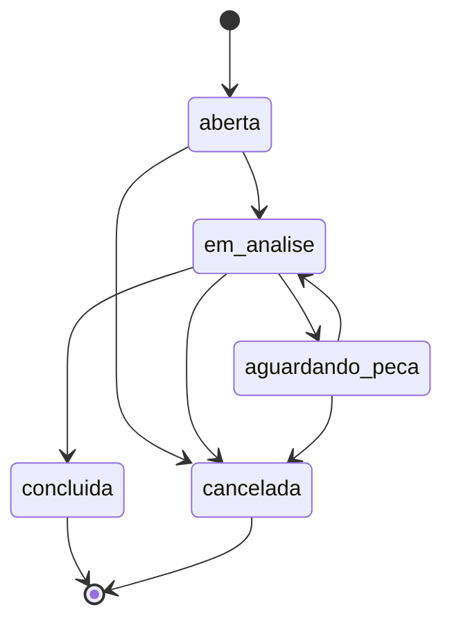

# Sistema de Ordens de Serviço

API para uma assistência técnica de computadores: cadastro de clientes e equipamentos, abertura de ordens de serviço e controle do andamento, com histórico de cada mudança de status.

Feita em Python com FastAPI e SQLite, com testes automatizados.

## Como rodar

Requer Python 3.10 ou superior.

```bash
python -m venv .venv
source .venv/bin/activate
pip install -r requirements.txt
uvicorn app.main:app --reload
```

No Windows, ative o ambiente com `.venv\Scripts\activate`.

Abra http://127.0.0.1:8000/docs para testar todos os endpoints pelo navegador. O banco `ordens.db` é criado automaticamente na primeira execução.

## Testes

```bash
python -m pytest
```

## Modelo de dados



## Fluxo de status de uma ordem



Qualquer mudança fora desse fluxo retorna erro 409, e ordens encerradas não podem mais ser alteradas.

## Endpoints

| Método | Rota | O que faz |
|---|---|---|
| POST, GET | `/clientes` | Cria e lista clientes (`?busca=` filtra pelo nome) |
| GET, PUT, DELETE | `/clientes/{id}` | Consulta, atualiza e remove um cliente |
| POST, GET | `/equipamentos` | Cria e lista equipamentos (`?cliente_id=` filtra) |
| GET | `/equipamentos/{id}` | Consulta um equipamento |
| POST, GET | `/ordens` | Abre e lista ordens (`?status=` filtra) |
| GET, PATCH | `/ordens/{id}` | Consulta com histórico, e atualiza diagnóstico e valor |
| PATCH | `/ordens/{id}/status` | Muda o status seguindo o fluxo permitido |
| GET | `/relatorios/resumo` | Total de ordens por status e valor das concluídas |

## Estrutura

```
app/schema.sql     tabelas, restrições e índices do banco
app/database.py    conexão com o SQLite
app/main.py        modelos de validação e rotas
tests/test_api.py  testes de cada regra de negócio
```

## O que este projeto pratica

- **Banco de dados:** chaves estrangeiras, restrições `CHECK`, índices, `JOIN` e `GROUP BY` (veja `schema.sql` e o relatório em `main.py`)
- **API REST:** verbos HTTP, códigos de status (201, 404, 409, 422) e validação de entrada com Pydantic
- **Regras de negócio:** transições de status válidas e transações que gravam a ordem e o histórico juntos
- **Testes:** cada regra tem um teste que falha se ela quebrar

## Roteiro

- [x] Marco 1: modelagem do banco
- [x] Marco 2: cadastro de clientes e equipamentos
- [x] Marco 3: ordens de serviço com status e histórico
- [ ] Marco 4: tela web que consome a API
- [ ] Marco 5: Docker e GitHub Actions rodando os testes
- [ ] Marco 6: login, relatórios e sugestão de prioridade com IA
