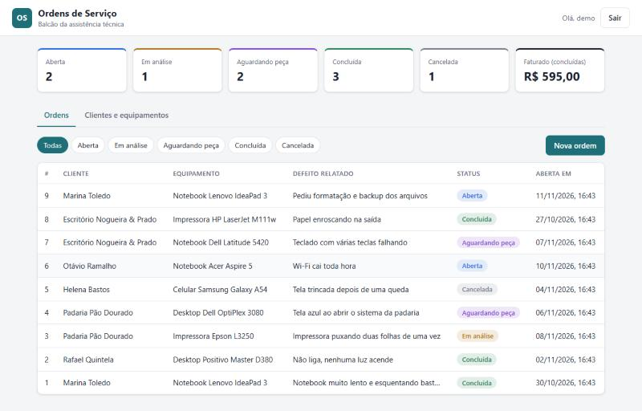
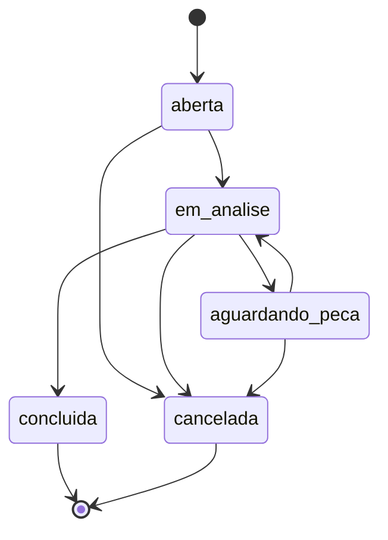
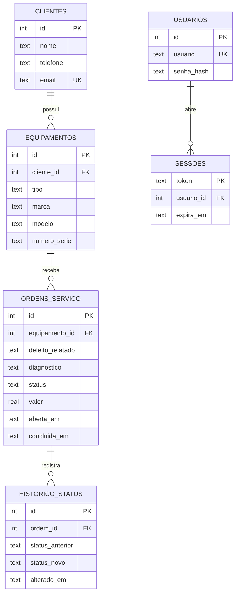

# Sistema de Ordens de Serviço

Sistema para o balcão de uma assistência técnica de computadores. Ele registra os clientes e os equipamentos que eles trazem, abre ordens de serviço e acompanha cada uma até o fim, guardando o histórico de todas as mudanças de status.

Escolhi esse problema porque conheço de perto a rotina de uma assistência: o cliente chega com o notebook, alguém anota o defeito, o técnico analisa, às vezes espera uma peça, e no fim o serviço é entregue ou cancelado. É um fluxo simples de explicar, mas que tem regras de verdade, e foi isso que eu quis modelar.

É feito em Python com FastAPI, SQLite e uma tela web em HTML, CSS e JavaScript puros, servida pela própria API.

## O que ele faz

O cadastro de clientes pede nome e telefone, com e-mail opcional, e recusa e-mail repetido. Cada cliente pode ter vários equipamentos, com tipo, marca, modelo e número de série.

Uma ordem nasce como "aberta", ligada a um equipamento e com o defeito relatado pelo cliente. A partir daí o status só muda por um caminho permitido, e cada mudança vai para o histórico com data e hora. O diagnóstico e o valor podem ser preenchidos enquanto a ordem está em andamento. Depois de concluída ou cancelada, ela fica travada.

No topo da tela ficam os números do dia a dia: quantas ordens há em cada status e quanto já foi faturado com as concluídas. Dá para filtrar a lista por status, clicar numa ordem para ver os detalhes e o histórico, e cadastrar clientes e equipamentos na outra aba.

Consultar é livre. Para cadastrar ou alterar qualquer coisa é preciso entrar com usuário e senha.

## Como funcionam as transições de status

As regras ficam num dicionário só, `TRANSICOES`, em `app/main.py`: para cada status, o conjunto de status para onde ele pode ir. Quando chega um pedido de mudança, a API olha o status atual da ordem, confere se o novo está na lista e, se não estiver, responde **409 Conflict** com o status atual e os caminhos permitidos. A tela usa essas informações para mostrar uma mensagem clara, como "uma ordem Aberta só pode ir para Cancelada ou Em análise", em vez de um erro genérico.

Quando a mudança é válida, o novo status e a linha do histórico são gravados na mesma transação. Se uma das duas falhar, nenhuma fica gravada, e o histórico nunca fica diferente do status real.

## Como funciona o login

As senhas nunca são guardadas como texto. Cada usuário tem um hash feito com PBKDF2-SHA256 (da biblioteca padrão do Python, `hashlib.pbkdf2_hmac`), com um salt aleatório e 200 mil iterações. O banco guarda tudo numa string só, no formato `pbkdf2_sha256$iterações$salt$hash`, então dá para aumentar as iterações no futuro sem quebrar as senhas antigas. Na hora de conferir, a comparação é feita com `hmac.compare_digest`, que leva o mesmo tempo dando certo ou errado.

Quando o login dá certo, a API gera um token aleatório (`secrets.token_urlsafe`) e guarda na tabela `sessoes`, com validade de 8 horas. A tela manda esse token no cabeçalho `Authorization: Bearer ...` em todo pedido de escrita. Sair apaga a sessão do banco, então o token deixa de valer na hora.

Preferi um token guardado no banco em vez de JWT porque, num sistema desse tamanho, poder encerrar uma sessão na hora vale mais do que não precisar consultar o banco. Senha errada e usuário inexistente devolvem a mesma mensagem, para não entregar quais usuários existem.

## Por que SQL puro

O acesso ao banco é feito com o módulo `sqlite3` e consultas escritas à mão, sem ORM. Foi de propósito: eu queria entender o que de fato vai para o banco, montar os `JOIN`, os `GROUP BY` e as transações eu mesmo, e ver as restrições funcionando no próprio esquema. Todas as consultas usam parâmetros (`?`), nunca texto concatenado, o que evita SQL injection.

O esquema fica em `app/schema.sql` e tem chaves estrangeiras, restrições `CHECK` (tipo do equipamento, status e valor não negativo) e índices nas colunas que as consultas mais usam. Algumas regras ficam no banco e na API ao mesmo tempo: um cliente que tem ordens não pode ser removido, porque a chave estrangeira impede, e a API transforma isso num 409 com uma mensagem legível.

## A tela web

A tela fica em `app/static/` e não tem framework nem etapa de build: um HTML, um CSS e um JavaScript que conversa com a API usando `fetch`. Isso deixa claro que a interface é só mais um cliente da API, igual a qualquer outro. Os textos vindos do banco entram na página com `textContent`, nunca como HTML, para que um nome de cliente não consiga injetar código na tela.

## Rotas

| Método | Rota | O que faz | Precisa de login |
|---|---|---|---|
| POST | `/login` | Confere usuário e senha e devolve um token | — |
| POST | `/logout` | Encerra a sessão atual | sim |
| GET | `/me` | Mostra quem está logado | sim |
| POST, GET | `/clientes` | Cria e lista clientes (`?busca=` filtra pelo nome) | só o POST |
| GET, PUT, DELETE | `/clientes/{id}` | Consulta, atualiza e remove um cliente | PUT e DELETE |
| POST, GET | `/equipamentos` | Cria e lista equipamentos (`?cliente_id=` filtra) | só o POST |
| GET | `/equipamentos/{id}` | Consulta um equipamento | — |
| POST, GET | `/ordens` | Abre e lista ordens (`?status=` filtra) | só o POST |
| GET, PATCH | `/ordens/{id}` | Consulta com o histórico e atualiza diagnóstico e valor | só o PATCH |
| PATCH | `/ordens/{id}/status` | Muda o status seguindo o caminho permitido | sim |
| GET | `/relatorios/resumo` | Ordens por status e valor das concluídas | — |

Os erros têm significado: 401 quando falta login ou o token não vale mais, 404 quando não encontra, 409 em conflito (e-mail repetido, transição inválida, ordem encerrada) e 422 quando o dado enviado não passa na validação. A documentação interativa que o FastAPI gera fica em `/docs`.

## Dados de exemplo

O arquivo `app/seed.py` cria um usuário de demonstração e um conjunto de clientes, equipamentos e ordens em vários status, todos inventados. Ele monta o histórico de cada ordem passando pelas mesmas transições da API, então os dados de exemplo nunca contam uma história que o sistema não permitiria. Se o banco já tem clientes, ele não duplica nada.

## Testes, CI e Docker

São 20 testes com pytest, cada um rodando num banco SQLite novo e vazio. Eles cobrem e-mail repetido, dados inválidos, equipamento de cliente que não existe, o fluxo completo de uma ordem, transição inválida, ordem encerrada que não pode ser editada, cliente com ordens que não pode ser removido e o relatório. Do lado do login: senha guardada como hash, salt diferente a cada vez, senha errada, escrita sem token, token inventado, token expirado e logout invalidando o token. Também há testes para o seed e para a tela ser servida.

Um workflow do GitHub Actions (`.github/workflows/tests.yml`) roda todos os testes a cada push e pull request.

O `Dockerfile` monta uma imagem com Python 3.12, roda a aplicação com um usuário sem privilégios de administrador e guarda o banco num volume em `/dados`, separado do código. Ao subir, o container roda o seed e depois o servidor.

## Próximos passos

- Perfis de usuário (atendente e técnico), com permissões diferentes.
- Guardar só o hash do token no banco, como já é feito com a senha.
- Migrar o banco para PostgreSQL quando houver mais de um técnico usando ao mesmo tempo.
- Imprimir o comprovante da ordem para entregar ao cliente.
